# UNIVERSIDAD TECMILENIO

**ACTIVIDAD:** Actividad 3 

**DOCENTE:** Francisco Gómez Rubio

**MATERIA:** Ciberseguridad

**ALUMNO:** CÉSAR JULIÁN ESPRONCEDA PANTOJA

**MATRÍCULA:** AL07040765

*10 de noviembre del 2026*

**ALCARACIÓN: ESTE README ES LO MISMO QUE EL DOCUMENTO QUE SE ENCUENTRA EN EL FOLDER DE "Documento de la actividad" PERO LO ADAPTE A MD PARA QUE FUERA MÁS CÓMODO DE LEER Y DE VERIFICAR EL CÓDIGO EN GENERAL**
---

## Índice

* [Introducción](#introducción)
* [Fase 1](#fase-1)
* [Fase 2](#fase-2)
* [Fase 3](#fase-3)
* [Política IAM restrictiva en AWS](#política-iam-restrictiva-en-aws)
* [Diagrama de arquitectura](#diagrama-de-arquitectura)
* [Conclusión](#conclusión)

---

## Introducción

En el presente documento se presenta la Actividad 3 de esta misma materia, la cual contiene 3 fases, las cuales son: Fase 1, bucket S3 cifrado y con acceso público bloqueado con Terraform; Fase 2, escaneo de una imagen de Docker con Trivy; y Fase 3, una autenticación JWT en una API probada con OWASP ZAP. Al igual, se realizó una política IAM y un diagrama de la arquitectura. Por último, es importante mencionar que no usé AWS sino LocalStack, por lo que todo el código se encuentra en las carpetas de este repositorio, tal como usted Paco nos mencionó. Al igual omití información y capturas para no hacer el documento tan largo, tal como las capturas de creación de cuenta en LocalStack y cosas por el estilo.

---

## Fase 1

Con Terraform creé el bucket **"actividad3-seguro-local"** con cifrado AES-256 y los 4 controles de bloqueo de acceso público. Dicho código **"main.tf"** tiene 3 recursos, debido a que en las versiones más recientes del provider de AWS el cifrado y el bloqueo ya no se declaran dentro del recurso del bucket. El provider apunta al endpoint de LocalStack con credenciales falsas y LocalStack se levanta con Docker Compose, expuesto solo en 127.0.0.1. Todo esto se encuentra en la carpeta **"[fase1-terraform](fase1-terraform/)"** del repositorio.

LocalStack quedó en estado healthy y terraform plan indicó que se crearían 3 recursos, mientras que terraform apply los creó.

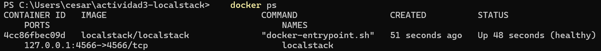

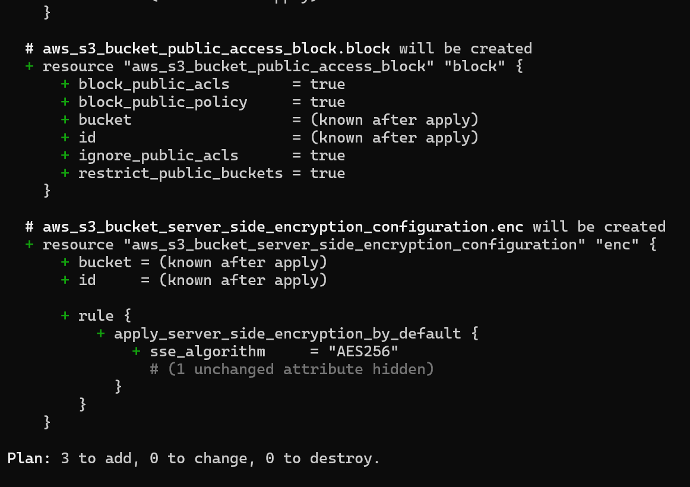

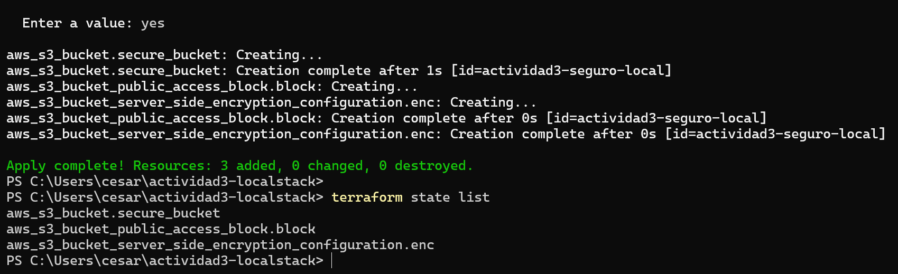

Para validar desde la línea de comandos usé AWS CLI con un endpoint local y credenciales ficticias, tal como se ve en la siguiente captura, donde el bucket existe, el cifrado es AES256 y los 4 bloqueos de acceso público están en true.

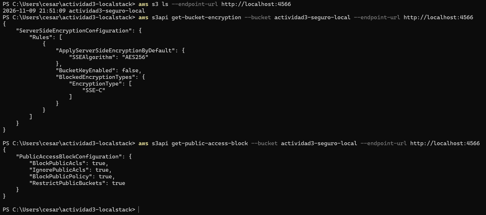

Después subí un archivo de prueba, el cual intenté descargar, y fue permitido por LocalStack, pero no lo interpreté como que el bucket sea público, ya que es un simulador y no replica las reglas de autorización de AWS. Al igual, el error **"NoSuchBucketPolicy"** solo indica que el bucket no tiene una política adjunta. Por último, el bucket y el archivo se ven en el Dashboard de LocalStack:

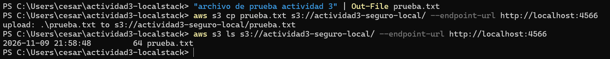

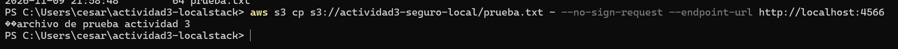

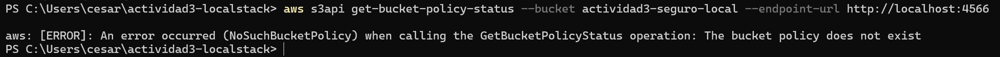

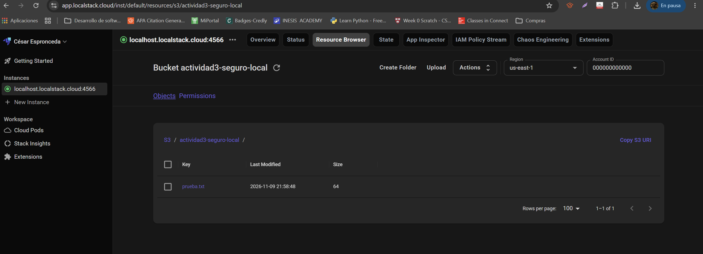

Para cerrar la fase: una cosa es la infraestructura declarada en el código (`main.tf`), otra la configuración consultada con AWS CLI (AES256 y los 4 bloqueos en true) y otra la seguridad que realmente se aplica, debido a que LocalStack es un simulador y que me dejara descargar el archivo sin firmar lo tomo como una limitación suya y no como una prueba de que el bucket sea público.

---

## Fase 2

Aquí en esta parte construí una imagen con una versión base que estuviera obsoleta, tal como es node 14, la escaneé con Trivy y después la mitigué cambiando la imagen base a node 18 y, como esta no fue suficiente, a node 22 alpine, escaneando cada cambio. Los Dockerfile, la aplicación de prueba y los reportes completos de Trivy se encuentran en la carpeta **"[fase2-contenedores](fase2-contenedores/)"** del repositorio. Los escaneos filtran las severidades HIGH y CRITICAL.

Con node 14, Trivy detectó Debian 10.13 y 23 vulnerabilidades críticas y 572 altas en total. Además, advirtió que esa versión de Debian ya no tiene soporte, por lo que en realidad el número podría ser mayor. Entre las críticas aparecen paquetes como git, libpython2.7, openssh-client y python2.7.

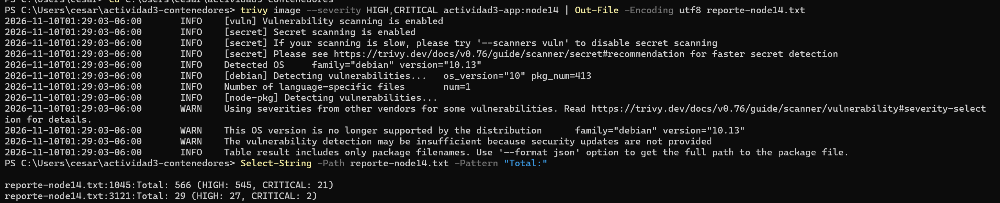

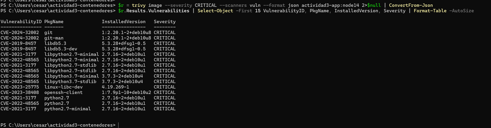

Con node 18 el resultado empeoró, ya que me arrojó 228 críticas y 2302 altas. Esto se debe a que Trivy detecta con información completa las vulnerabilidades de Debian 12, que es el sistema de esa imagen, mientras que para Debian 10 su detección era insuficiente.

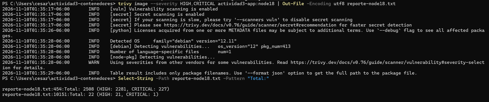

Mientras que con node 22 alpine, la cual es una versión con soporte y una distribución más pequeña, 19 paquetes contra 413 de las imágenes de Debian, el reporte quedó sin vulnerabilidades críticas, tal como se presenta en la siguiente imagen:

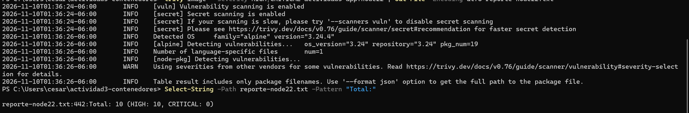

Al igual, en la siguiente tabla resumo los 3 escaneos realizados:

| Imagen | Sistema base | Paquetes | Críticas | Altas |
|---|---|---|---|---|
| Node 14 | Debian 10.13 | 413 | 23 | 572 |
| Node 18 | Debian 12.11 | 413 | 228 | 2302 |
| Node 22 alpine | Alpine 3.24.4 | 19 | 0 | 10 |

En conclusión para esta fase, me quedó claro que no solamente actualizando la imagen base se reducen las vulnerabilidades, ya que pasar de node 14 a 18 las aumentó. Lo que sí funcionó fue node 22 alpine, que quedó sin críticas.

---

## Fase 3

La API simulada está hecha con Node.js, Express y jsonwebtoken, y su código se encuentra en la carpeta **"[fase3-api](fase3-api/)"** del repositorio. Tiene 2 endpoints públicos **"/api/public"** y **"/api/login"** y 3 endpoints protegidos **"/api/perfil"**, **"/api/admin"** y **"/api/admin/usuarios"**. El login devuelve un token firmado con HS256 que expira en 15 minutos y el secreto no está en el código, sino que se lee de la variable de entorno **"JWT_SECRET"**. La validación se hace con 2 middlewares: **verifyToken** revisa la firma y la expiración, mientras que **requireRole** revisa el rol. Ambos se aplican a los endpoints sensibles **"/api/admin"** y **"/api/admin/usuarios"**, y **verifyToken** también a **"/api/perfil"**.

Al igual, probé los endpoints con curl.exe: sin token y con el token alterado respondieron con error 401; con el token de un usuario normal, **"/api/admin"** respondió con el error 403 y **"/api/perfil"** con 200; y con el token del admin los dos endpoints sensibles respondieron con 200.

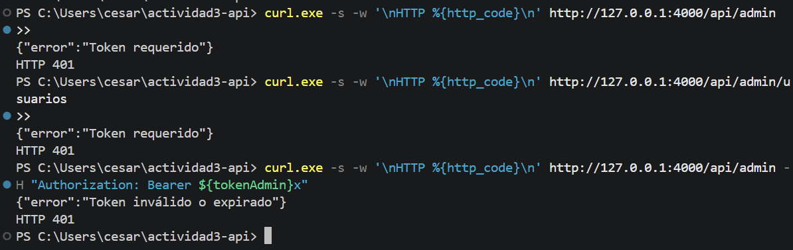

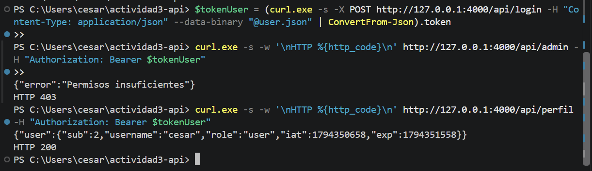

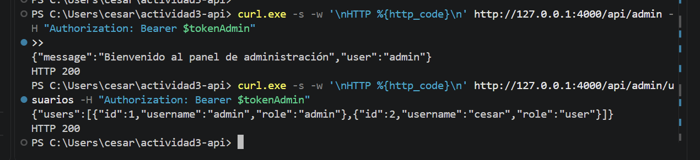

| Prueba | Código | Respuesta |
|---|---|---|
| Sin token en **/api/admin** y **/api/admin/usuarios** | 401 | Token requerido |
| Token con la firma alterada | 401 | Token inválido o expirado |
| Usuario normal en **/api/admin** | 403 | Permisos insuficientes |
| Usuario normal en **/api/perfil** | 200 | Perfil del usuario |
| Admin en **/api/admin** y **/api/admin/usuarios** | 200 | Acceso permitido |

Después importé la definición de la API **"/openapi.json"** en OWASP ZAP y la escaneé. El reporte tuvo 0 alertas altas, 0 medias, 2 bajas y 1 informativa: el servidor divulga que usa Express por el encabezado **X-Powered-By** y falta el encabezado **X-Content-Type-Options**. ZAP no encontró ningún endpoint sensible accesible sin autenticación; en su historial, las peticiones sin token a **"/api/perfil"**, **"/api/admin"** y **"/api/admin/usuarios"** respondieron 401.

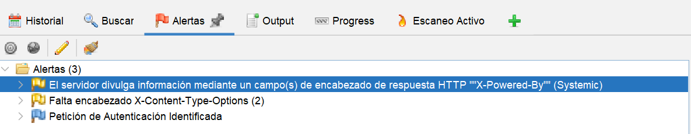

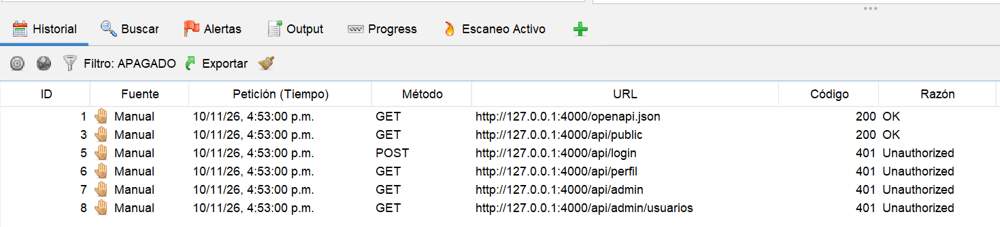

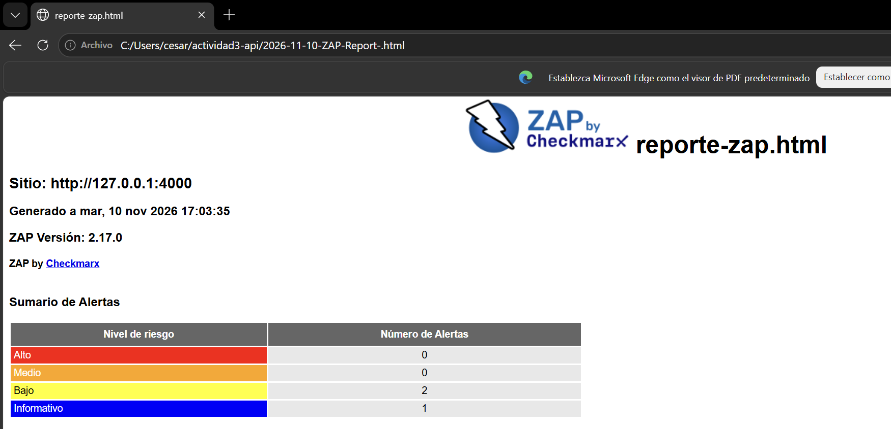

Las 2 alertas bajas se corrigieron agregando el paquete helmet en server.js, que añade encabezados de seguridad y quita el **X-Powered-By**. Con un escaneo nuevo el reporte ya no tiene alertas bajas:

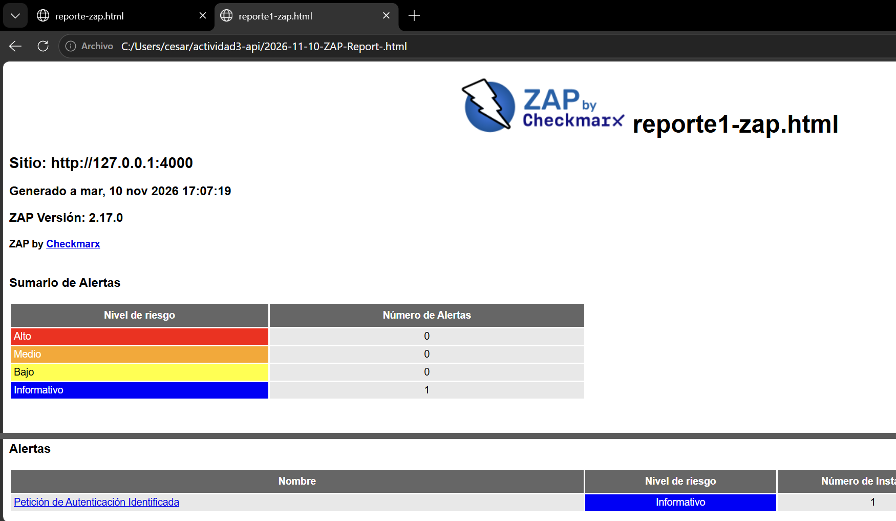

---

## Política IAM restrictiva en AWS

Para limitar el acceso al bucket solo a los roles necesarios apliqué el principio de mínimo privilegio con 3 archivos JSON, que se encuentran en la carpeta **"[iam](iam/)"** del repositorio:

| Archivo | Qué define |
|---|---|
| politica-iam-lectura.json | Permisos del rol rol-lectura-actividad3: solo s3:GetObject sobre los objetos del bucket y s3:ListBucket sobre el bucket |
| trust-policy-rol-lectura.json | Política de confianza: solo las tareas de contenedores de ECS pueden asumir el rol |
| politica-bucket.json | Política del bucket: niega todo acceso que no venga del rol de lectura o del de administración y niega cualquier petición que no use HTTPS |

Debido a que una denegación explícita tiene prioridad sobre un permiso, ni un administrador de la cuenta podría leer el bucket sin usar uno de esos roles. Dichas políticas no se hicieron cumplir en el laboratorio, debido a que el plan Hobby de LocalStack no incluye la aplicación de políticas IAM; solo validé que los JSON tuvieran formato correcto y el número de cuenta que aparece en ellos es el que usa LocalStack. En la siguiente tabla se muestra el ejemplo de uso en AWS real:

| Quién | Acción | Resultado esperado |
|---|---|---|
| Rol de lectura | GetObject sobre prueba.txt | Permitido |
| Rol de lectura | PutObject | AccessDenied: no está en su política |
| Rol de lectura | GetObject por HTTP sin cifrar | AccessDenied por la política del bucket |
| Otro usuario o rol de la cuenta | Cualquier acción sobre el bucket | Denegado |
| Acceso anónimo | GetObject | Denegado |

---

## Diagrama de arquitectura

En la siguiente imagen se muestra la arquitectura segura que integra las 3 fases y la política IAM. Debido a que la API del laboratorio es simulada y no se conecta realmente a S3, el diagrama representa la arquitectura objetivo:

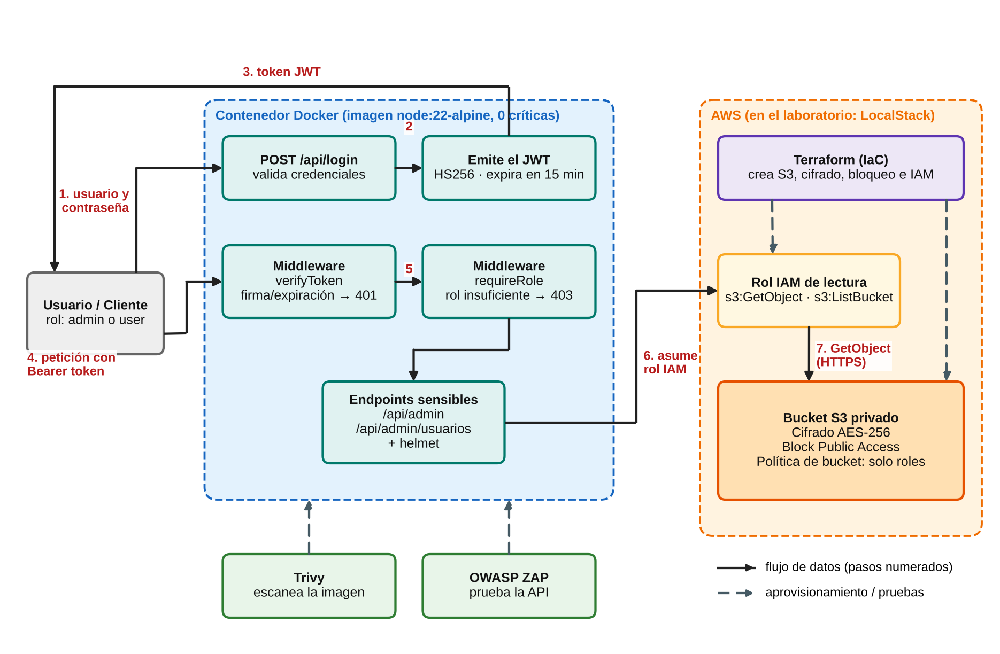

El flujo de datos es el siguiente:

1. El usuario envía su usuario y contraseña a **/api/login**.
2. La API, en un contenedor Docker con node 22 alpine, valida las credenciales.
3. La API emite un JWT que expira en 15 minutos.
4. El usuario envía el token como Bearer a los endpoints sensibles.
5. verifyToken valida la firma y la expiración y requireRole valida el rol.
6. La tarea de la API asume el rol IAM de lectura.
7. El rol lee el bucket por HTTPS: cifrado AES-256, sin acceso público y con una política que solo permite a los roles definidos.

---

## Conclusión

En conclusión, realizar esta actividad me ayudó a que me quedara claro que la seguridad se aplica por capas y que cada una hay que comprobarla: en la infraestructura declaré con Terraform un bucket cifrado y sin acceso público y lo consulté con AWS CLI; en el contenedor escaneé la imagen con Trivy hasta dejarla sin críticas; en la aplicación protegí los endpoints con JWT y roles y los probé con curl y ZAP; y en el acceso limité el bucket a roles con permisos mínimos con políticas IAM.

Al igual, varios resultados tuve que leerlos con cuidado y no darlos por hecho, tal como que LocalStack me dejó descargar un archivo sin firmar, que node 18 aumentó las críticas en lugar de bajarlas y que ZAP escaneó sin un token.
